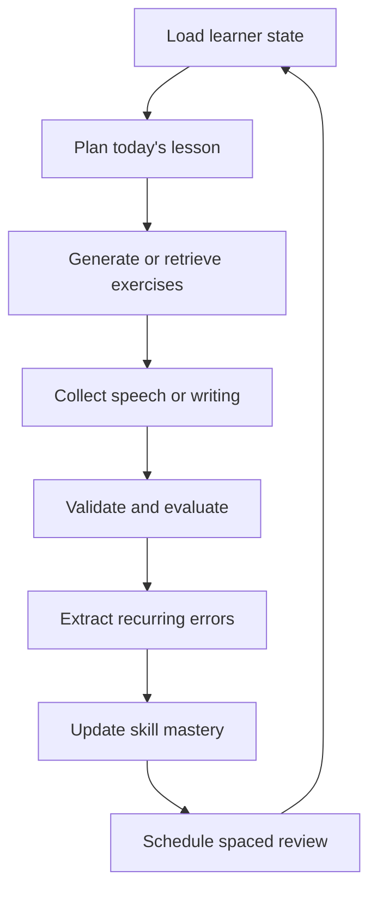
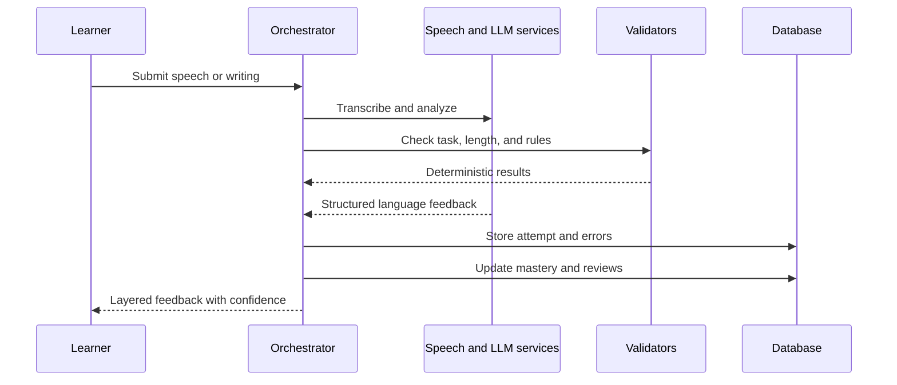
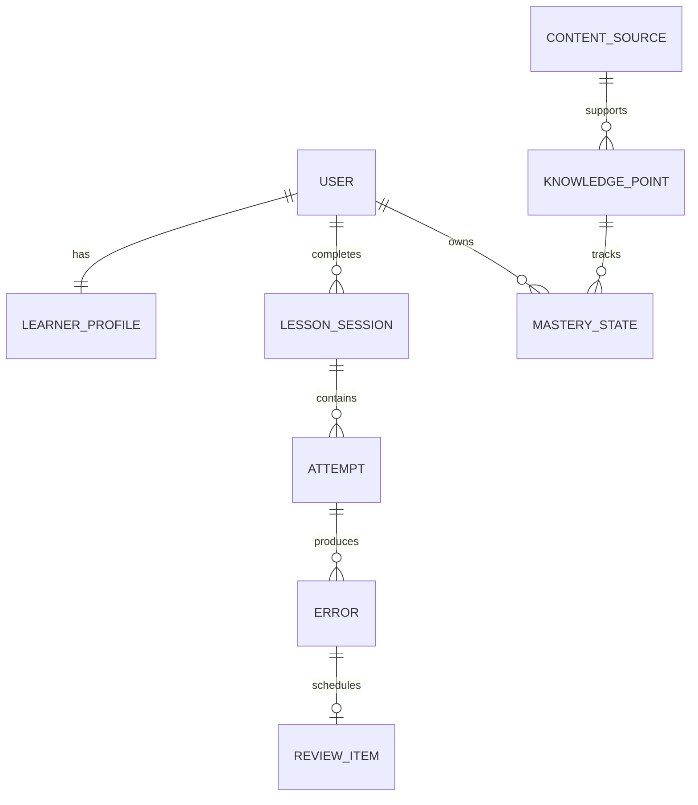

# Adaptive TCF Canada French Learning Agent

An AI-native, multimodal French learning system that builds a persistent learner model, generates adaptive daily lessons, tracks recurring mistakes, schedules spaced reviews, and prepares learners for the four components of the **TCF Canada** exam.

> **Project status:** Design and MVP planning. Features and metrics described as targets are clearly marked and must not be presented as completed work until implemented and measured.

## Why This Project Exists

Most language-learning products offer the same lesson sequence to every learner. General-purpose AI chatbots are flexible, but they usually forget long-term learning state, provide inconsistent corrections, and cannot reliably distinguish official exam rules from generated advice.

This project focuses on the missing orchestration layer:

* What has the learner already studied?
* Which errors keep recurring?
* What is likely to be forgotten next?
* Which skill is blocking the learner from reaching NCLC 7?
* What should the learner practice today, given the available time?
* How confident should the system be in its feedback?

The product is not intended to recreate a dictionary, a complete French curriculum, or a generic chatbot. It is a personal learning operating system that connects authoritative material, AI-generated practice, learner output, evaluation, and spaced repetition.

## Target User and Goal

The initial product is designed for one or two adult learners who:

* are preparing for Canadian economic immigration;
* need at least **NCLC 7 in listening, speaking, reading, and writing**;
* have limited study time because of full-time work or school;
* want personalized practice rather than a fixed classroom pace;
* need an auditable distinction between official rules and AI-generated content.

The initial target is TCF Canada, but the underlying learner-state and evaluation architecture can later support other proficiency exams.

## Core Product Loop



The workflow is implemented as a deterministic state machine. The language model fills constrained steps and calls explicit tools; it does not autonomously control the entire application.

## Product Requirements

### 1. Onboarding and Diagnostic Assessment

The application records:

* target exam and date;
* weekly study capacity;
* current French experience;
* native and working languages;
* preferred session length;
* initial confidence by skill.

The diagnostic includes short samples of:

* grammar and vocabulary;
* reading comprehension;
* listening comprehension;
* a 60-second speaking response;
* an 80-word writing response.

The result is a separate estimate for each skill rather than a single global level.

```json
{
  "listening": 0.12,
  "speaking": 0.08,
  "reading": 0.21,
  "writing": 0.14
}
```

### 2. Adaptive Daily Sessions

The lesson planner uses:

* due review items;
* recent and recurring errors;
* current curriculum position;
* estimated mastery by skill and knowledge point;
* available session length;
* recent workload and completion history;
* time remaining before the exam.

Example lesson plan:

```json
{
  "duration_minutes": 45,
  "blocks": [
    {"type": "retrieval_review", "minutes": 5},
    {"type": "comprehensible_input", "minutes": 10},
    {"type": "targeted_drill", "minutes": 10},
    {"type": "speaking", "minutes": 15},
    {"type": "reflection", "minutes": 5}
  ]
}
```

The user can select 15-, 30-, or 45-minute mode without losing continuity.

### 3. Speaking Lab

The speaking experience supports:

1. **Level-adjusted conversation** — vocabulary, speed, sentence length, and correction density adapt to the learner.
2. **Scenario role-play** — renting an apartment, requesting information, resolving a complaint, discussing a plan, or persuading another person.
3. **TCF simulation** — timed exam-style tasks with no coaching during the attempt.

For every attempt, the system may store:

* original audio;
* transcript and word-level timing when available;
* pauses, repetitions, and self-corrections;
* grammar and vocabulary observations;
* low-confidence transcript segments;
* human-review status.

The MVP must not claim reliable phoneme-level pronunciation scoring. Low-confidence audio should be escalated or marked uncertain rather than given false precision.

### 4. Writing Lab

The writing workflow supports:

* short guided writing;
* grammar-constrained writing;
* exam-style tasks;
* timed full-section practice;
* revision history and side-by-side comparison.

Evaluation occurs in stages:

1. deterministic checks for word count, time limit, and task completion;
2. AI identification of probable language errors;
3. learner self-correction;
4. explanation and improved alternatives;
5. error extraction and review scheduling.

The system should not immediately replace the learner's text with an idealized AI answer.

### 5. Structured Error Library

Errors are first-class records rather than unstructured chat history.

```json
{
  "category": "grammar",
  "concept": "passe_compose_auxiliary",
  "original": "Je suis travaille hier.",
  "correction": "J'ai travaille hier.",
  "explanation": "Travailler uses avoir in the passe compose.",
  "failure_count": 3,
  "success_streak": 1,
  "mastery": 0.46,
  "review_status": "active",
  "next_review_at": "2026-10-03T18:00:00Z"
}
```

The system deduplicates semantically equivalent errors and connects every error to its original attempt.

### 6. Mastery and Spaced Repetition

The product separates:

* **mastery** — whether the learner understands and can produce a concept;
* **memory state** — when a specific sentence, phrase, or correction is likely to be forgotten.

Suggested implementation:

* Beta-Bernoulli estimates or simplified Bayesian Knowledge Tracing for knowledge-point mastery;
* FSRS for scheduling review items;
* difficulty, hints, latency, and confidence as attempt features.

Every exercise is tagged with structured metadata:

```yaml
skill: speaking
concept: conditionnel_present
cefr_level: B1
difficulty: 0.62
task_type: opinion
source_type: generated
```

### 7. Progress and Weekly Reports

Reports should answer:

* How much time was spent learning?
* Which skills improved?
* Which errors are recurring?
* What is the weakest exam component?
* Which content should be prioritized next week?
* Is the learner on track for the planned exam date?

The system should present ranges and uncertainty instead of fabricated precision.

## TCF Canada Mode

The exam module should eventually support:

* official section structure and timing;
* separate listening, speaking, reading, and writing status;
* task-specific timers;
* full mock exams;
* versioned NCLC score mappings;
* performance trends across attempts;
* instructor-reviewed speaking and writing samples.

Official rules and score tables are stored as structured, versioned records. Exact numeric questions must use deterministic lookup rather than semantic retrieval.

## Agent Design

The system uses one orchestrator with explicit tool calls rather than a collection of loosely coordinated autonomous agents.

### Proposed Tools

```text
get_learner_profile()
get_due_reviews()
get_recent_errors()
retrieve_language_rule()
retrieve_tcf_requirement()
generate_exercise()
validate_deterministic_constraints()
analyze_response()
record_attempt()
update_mastery()
schedule_review()
generate_weekly_report()
```

### Response Processing



Model responses must conform to JSON Schema. The model never writes directly to persistent state; the application validates and applies proposed mutations.

## Trusted Data Architecture

### Layer 1: Official Rules

Examples include:

* exam structure and timing;
* NCLC conversion tables;
* official eligibility thresholds;
* task and length requirements;
* metadata for official sample material.

Every claim records provenance and validity:

```json
{
  "claim_key": "tcf_speaking_nclc_7",
  "value": {"minimum": 10, "maximum": 11},
  "publisher": "IRCC",
  "source_url": "https://example.gov/...",
  "effective_date": "2026-05-27",
  "last_verified_at": "2026-09-20",
  "version": 1
}
```

### Layer 2: Curated Language Knowledge

* CEFR-aligned concepts;
* grammar rules and examples;
* high-frequency vocabulary and constructions;
* curriculum chapter mappings;
* recurring errors made by Chinese-speaking learners.

This content must be licensed, original, or summarized within permitted use. The project should not ingest unauthorized copies of commercial textbooks or recalled live exam questions.

### Layer 3: Learner Data

* recordings and transcripts;
* writing submissions;
* attempts and feedback;
* errors and corrections;
* mastery and review state;
* human overrides.

This is the primary source of personalization.

### Layer 4: Synthetic Content

AI-generated material records:

* model identifier;
* prompt version;
* generation timestamp;
* source context;
* confidence;
* review status;
* user or instructor corrections.

Synthetic content does not automatically become trusted curriculum content.

## Data Model

Core entities:

```text
users
learner_profiles
skills
knowledge_points
content_sources
source_claims
lesson_sessions
exercises
attempts
errors
mastery_states
review_items
assessments
human_reviews
prompt_versions
model_runs
```



## Technical Architecture

### Recommended MVP Stack

| Layer              | Technology                                                |
| ------------------ | --------------------------------------------------------- |
| Web and PWA        | Next.js, React, TypeScript                                |
| API                | Next.js server routes or a lightweight Node service       |
| Relational data    | PostgreSQL                                                |
| Semantic retrieval | pgvector, only where semantic retrieval is useful         |
| Audio storage      | S3-compatible object storage                              |
| AI orchestration   | Structured output and tool-calling LLM                    |
| Speech             | Streaming speech-to-text and text-to-speech               |
| Review scheduler   | FSRS                                                      |
| Authentication     | Email or OAuth with strict per-user isolation             |
| Background work    | Lightweight queue for audio analysis and reports          |
| Testing            | Vitest, Playwright, fixed model evaluation sets           |
| Observability      | Structured logs, traces, latency, token, and cost metrics |
| CI/CD              | GitHub Actions                                            |

The MVP should remain a modular monolith. Kubernetes, Kafka, microservices, an independent vector database, custom model training, and multi-agent coordination are intentionally out of scope.

If audio analysis or evaluation later becomes compute-heavy, that workload can be separated into a Python worker without restructuring the entire product.

## Example API Surface

```text
POST /api/onboarding/diagnostic
POST /api/sessions/plan
GET  /api/sessions/today
POST /api/attempts
POST /api/speaking/transcribe
POST /api/evaluations
GET  /api/reviews/due
POST /api/reviews/:id/complete
GET  /api/errors
GET  /api/progress
GET  /api/reports/weekly
```

Long-running audio and evaluation jobs return a job identifier and expose status separately rather than holding an HTTP request open indefinitely.

## Reliability and Evaluation

AI feedback is a model output, not ground truth. The system combines deterministic validation, retrieval grounding, model review, uncertainty, and periodic human calibration.

### Evaluation Dataset

Initial target dataset:

* 100 correct and incorrect French sentences;
* 50 ambiguous or context-dependent expressions;
* 30 instructor-reviewed writing responses;
* 30 instructor-reviewed speaking samples;
* 50 task-completion cases;
* 20 stale or conflicting source cases;
* 20 irrelevant-input and prompt-injection cases.

### Metrics

| Metric                 | Purpose                                           |
| ---------------------- | ------------------------------------------------- |
| Error recall           | Percentage of human-labeled errors identified     |
| False correction rate  | Correct language incorrectly marked as wrong      |
| Explanation accuracy   | Correctness of the explanation                    |
| Grounding accuracy     | Correct use of authoritative rules                |
| Human agreement        | Agreement with instructor judgments               |
| Score MAE              | Difference between estimated and instructor score |
| Unsupported-claim rate | Confident claims without adequate support         |
| P50/P95 latency        | User-visible system performance                   |
| Cost per session       | AI and speech operating cost                      |

Uncertain evaluation example:

```json
{
  "estimated_nclc_range": [6, 8],
  "confidence": 0.48,
  "human_review_recommended": true,
  "reasons": [
    "audio transcription confidence was low",
    "argument structure met the task requirement",
    "pronunciation could not be reliably assessed"
  ]
}
```

## Privacy and Security

* Keep API credentials on the server.
* Encrypt learner data and recordings in transit and at rest.
* Enforce per-user authorization on every attempt, recording, and report.
* Allow recordings and history to be exported and deleted.
* Do not use learner content for model training without explicit consent.
* Avoid logging raw audio, private writing, or complete model prompts in production logs.
* Track the exact source and model version behind consequential feedback.

## Success Metrics

Product metrics:

* weekly active study days;
* completed sessions;
* speaking minutes;
* writing submissions;
* review completion rate;
* recurring-error rate;
* 7-, 30-, and 90-day retention;
* human override rate;
* cost and latency per session.

Learning metrics:

* mastery by skill and concept;
* repeated-error reduction;
* performance on held-out exercises;
* mock-exam trends;
* agreement between AI and instructor feedback;
* eventual NCLC results when available.

## Development Roadmap

### Phase 0: Manual Workflow Validation

Before building the product, run the proposed learning loop manually for two weeks using a fixed AI conversation and a spaced-repetition tool. Record the repetitive steps, missing state, and actual sources of friction.

**Exit criterion:** A short list of recurring problems that software can remove.

### Phase 1: Weekend MVP

* learner profile;
* daily lesson plan;
* text exercises and attempts;
* structured error extraction;
* error library;
* basic mastery state;
* next-review scheduling.

**Exit criterion:** The learner uses the application for seven consecutive study days.

### Phase 2: Closed Learning Loop

* audio recording and transcription;
* writing feedback workflow;
* FSRS integration;
* weekly reports;
* prompt and model versioning;
* latency and cost telemetry.

**Exit criterion:** Four weeks of regular use without manual record keeping.

### Phase 3: TCF Canada Module

* official rule store;
* speaking and writing task types;
* timers and full mock exams;
* NCLC conversion;
* instructor review workflow;
* evaluation dashboard.

**Exit criterion:** Repeated mock assessments with measurable agreement between AI feedback and instructor review.

### Phase 4: Optional Public Release

* onboarding for external users;
* content and licensing review;
* operational monitoring;
* abuse and quota controls;
* privacy policy and data retention controls;
* public demo and reproducible evaluation report.

This phase should only begin if the personal version demonstrates sustained learning value.

## Non-Goals

* Rebuilding a general-purpose French dictionary.
* Replacing a complete CEFR curriculum.
* Claiming that AI can replace certified instructors or examiners.
* Producing exact pronunciation or NCLC scores without sufficient evidence.
* Scraping copyrighted textbooks or live exam-recall banks.
* Building social feeds, leaderboards, avatars, or elaborate gamification.
* Using distributed infrastructure that is unnecessary for the initial scale.

## Potential Resume Evidence

The repository should collect evidence that can eventually support accurate resume bullets:

* number of completed sessions and attempts;
* labeled evaluation-set size;
* agreement with instructor assessments;
* reduction in unsupported corrections;
* recurring-error reduction;
* latency and cost improvements;
* public users, contributors, stars, or citations if the project is released.

No metric should be included in a resume until the measurement method and underlying data exist.

## License

License to be selected before public release. Third-party educational content, audio, and exam material must retain its original license and attribution requirements.
